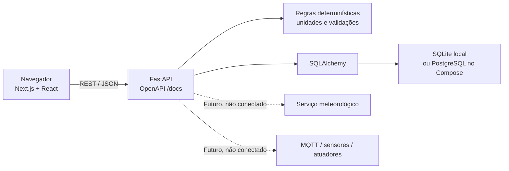
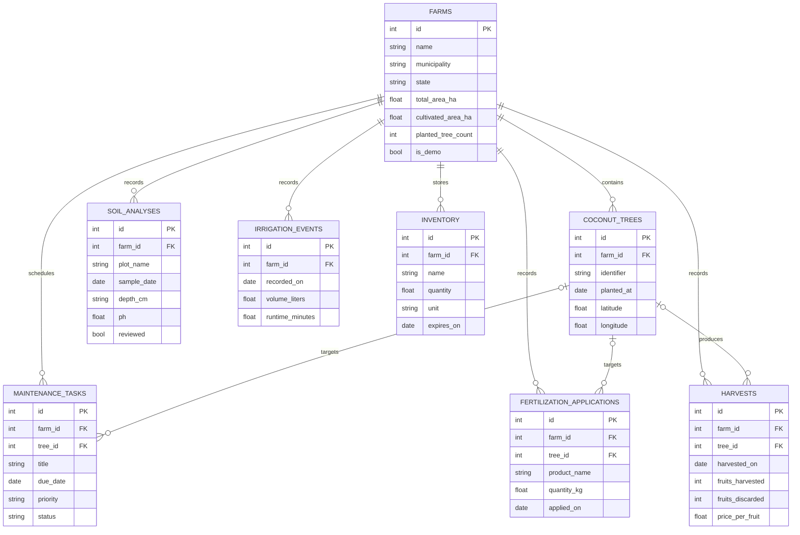

# Arquitetura do COCO SMART 360

## Escopo desta versão

Esta entrega implementa o MVP web em um monólito modular: Next.js/React/TypeScript na interface e FastAPI/SQLAlchemy no serviço, com SQLite para execução local e PostgreSQL/PostGIS no Compose. O backend mantém o cálculo separado de rotas e modelos; não há microsserviços.

## Modelo de dados do MVP

## API principal

- `GET /health`: disponibilidade e sinalizador do modo demonstração.
- `/api/v1/farms`, `/trees`, `/tasks`, `/soil-analyses`, `/fertilization-applications`, `/irrigation-events`, `/inventory` e `/harvests`: cadastro e consulta.
- `GET /api/v1/workspace?farm_id=...`: visão agregada do painel.
- `POST /api/v1/calculations/fertilizer`: conversão de metas fornecidas em produto e balanço de nutrientes.
- `POST /api/v1/calculations/irrigation`: estimativa ETc, lâmina, volume e duração opcional.
- `GET /api/v1/agronomic-references`: referências históricas explicitamente versionadas.
- `POST /api/v1/demo/seed`: conjunto ilustrativo, somente quando `COCO_DEMO_MODE=true`.

A especificação interativa e os schemas ficam disponíveis em `/docs` (Swagger UI) e `/openapi.json`.

## Limites e segurança

- O MVP não implementa autenticação, RBAC, isolamento multiusuário, sincronização offline ou trilha de auditoria completa. É destinado a avaliação local/rede confiável, não a exposição pública.
- A configuração CORS é restrita por origem; não há credenciais CORS habilitadas.
- A API não tem rotas de acionamento de bomba, válvula ou equipamento. Cálculos sempre retornam `execution_authorized=false`.
- Nenhuma decisão agronômica é derivada automaticamente de fotografia, análise laboratorial ou clima. A leitura manual de laudos tem flag de conferência.
- A integração de clima não está configurada e valores meteorológicos reais não são simulados.
- Use segredo próprio no `.env`, TLS, autenticação, backups e revisão de segurança antes de qualquer implantação externa.

## Evolução prevista

1. Identidade e papéis; auditoria e isolamento por propriedade.
2. Migrações e regras agronômicas revisadas com fontes regionais atuais.
3. Importação de análises laboratoriais e conector meteorológico confiável.
4. Mobile/offline, mapas georreferenciados, QR Code e ingestão IoT segura.
5. RAG e visão computacional com avaliação de dados e validação profissional.

